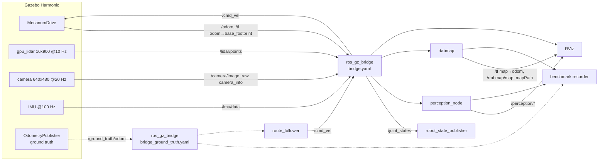

# Architecture

WSL is a simulated warehouse robot plus the software that perceives, maps and
measures it. Five packages, each owning one responsibility:

| Package | Owns | Contains code? |
|---|---|---|
| `wsl_description` | Robot hardware: geometry, inertia, joints, sensor frames, Gazebo sensor and drive definitions | Xacro + tests |
| `wsl_sim` | Simulation runtime: warehouse world and assets, ROS–Gazebo bridge, full-system launch, RViz | World/launch/config + tests |
| `wsl_perception` | 3D point-cloud processing: validation, filtering, ground removal, clustering | C++ library + node |
| `wsl_slam` | RTAB-Map configuration and launch | Config + launch only |
| `wsl_benchmark` | Evaluation: scenarios, route driving, recording, metrics | Python |

`wsl_slam` has no code on purpose: RTAB-Map is mature, and the engineering work
is choosing its inputs and parameters. Forking it would add maintenance without
adding capability.

## Data flow

Dotted edges exist only in benchmark runs (`ground_truth:=true`).

## Interfaces

| Topic | Type | Producer | Consumers |
|---|---|---|---|
| `/cmd_vel` | `geometry_msgs/Twist` | teleop / `route_follower` | MecanumDrive (via bridge) |
| `/odom` | `nav_msgs/Odometry` | MecanumDrive | recorder |
| `/tf` | `tf2_msgs/TFMessage` | MecanumDrive (`odom→base_footprint`), robot_state_publisher (wheels), rtabmap (`map→odom`) | all |
| `/tf_static` | `tf2_msgs/TFMessage` | robot_state_publisher | all |
| `/joint_states` | `sensor_msgs/JointState` | Gazebo JointStatePublisher | robot_state_publisher |
| `/lidar/points` | `sensor_msgs/PointCloud2` (`lidar_link`, x y z intensity ring, organised 16×900) | gpu_lidar | perception, rtabmap, RViz, recorder |
| `/camera/image_raw` | `sensor_msgs/Image` (`rgb8`, `camera_optical_frame`) | camera | RViz, recorder |
| `/camera/camera_info` | `sensor_msgs/CameraInfo` | camera | recorder |
| `/imu/data` | `sensor_msgs/Imu` (`imu_link`) | IMU | recorder |
| `/perception/filtered_points` | `PointCloud2` (`base_footprint`) | perception | recorder |
| `/perception/obstacle_points` | `PointCloud2` (`base_footprint`) | perception | RViz |
| `/perception/clusters` | `vision_msgs/Detection3DArray` | perception | recorder |
| `/perception/markers` | `visualization_msgs/MarkerArray` | perception | RViz |
| `/rtabmap/map` | `nav_msgs/OccupancyGrid` | rtabmap | RViz |
| `/rtabmap/mapPath` | `nav_msgs/Path` (optimised graph poses) | rtabmap | RViz, recorder |
| `/rtabmap/info` | `rtabmap_msgs/Info` | rtabmap | recorder |
| `/ground_truth/odom` | `nav_msgs/Odometry` (`world`) | Gazebo OdometryPublisher | recorder, route_follower |
| `/diagnostics` | `diagnostic_msgs/DiagnosticArray` | perception | operators |

Gazebo-side names live under `/wsl/`; `wsl_sim/config/bridge.yaml` is the only
place where they are mapped to the ROS names above. A test checks that every
bridged Gazebo topic is actually declared by the robot model.

## Decisions

**Single source of truth for geometry.** The URDF/Xacro in `wsl_description`
is used by both Gazebo (spawned from `/robot_description`) and
robot_state_publisher, so simulated sensor poses and TF cannot disagree.
Inertia is computed from the primitive shapes by Xacro macros rather than typed
in, and a test checks every tensor is positive definite and satisfies the
triangle inequality.

**Robotnik meshes for visuals, primitives for collisions.** The robot is the
RB-Summit-XL Steel. Its chassis, cover and wheel meshes are visual only; the
collision model is one box around the chassis mesh, spheres for the wheels and
cylinders for the mast and LiDAR. The meshes stay in the units and origins they
ship with and are redistributed under their BSD-3-Clause licence
([third-party assets](../README.md#third-party-assets)). Chassis and cover take
their colours from URDF materials. The wheel meshes carry two COLLADA materials,
rim and rollers, so their visuals have no URDF material: RViz always uses the
materials inside a COLLADA file and Gazebo would flatten both parts to a single
URDF colour, so this is the way both renderers show the same colours.

**Mecanum drive, not skid-steer.** Measured on the warehouse floor with the same
drive sequence:

| Model | Commanded → measured turn rate | Odometry heading error per turn | Verdict |
|---|---|---|---|
| A: MecanumDrive, sphere wheels, μ = 1 | 1.00 → 1.000 rad/s | 0.00° | chosen |
| A: MecanumDrive, cylinder wheels | 1.00 → 1.131 rad/s | 43.6° | contact is off the axle |
| B: skid-steer on DiffDrive, μ = 1 | 1.00 → 0.000 rad/s | 362° | does not turn |
| B: skid-steer on DiffDrive, μ = 0.3 | 1.00 → 0.000 rad/s | 362° | does not turn |

The wheelbase (0.445 m) is longer than the track (0.409 m), so with isotropic
friction the lateral friction moment exceeds what the wheels can apply, at any μ.
The real robot has mecanum wheels, so A is also the faithful choice. `/cmd_vel`
keeps its meaning, with `linear.y` now also available, and `/odom` is integrated
from wheel joint positions as before.

Two properties of the Harmonic plugin matter. It reads only the combined
`min/max_velocity` and `min/max_acceleration`; the per-axis names of later
versions are ignored without a message, which leaves the robot limited only by
friction (6.9 m/s² was measured). With one value for all axes, the limit is
1 m/s² and 1 rad/s². A test pins these names. Yaw depends on the sum of
separation and wheelbase, so `odom_wheel_separation_scale` scales both, and a
3% scale still means a 3% turn-rate error. The resulting heading error on the
closed loop is 13.97° against 360° × (1 − 0.99 / 1.03) = 13.98° predicted.

**Contact parameters.** Only `mu`, `mu2` and `fdir1` are set on the wheels. The
gz-physics DART backend reads `mu`, `mu2`, `fdir1`, `slip1`, `slip2` and `bounce`
and never reads `kp`, `kd`, `min_depth` or `max_vel`. Setting `kp` to 1e3 and to
1e9 gave identical results to the unset case, so they are left out. μ = 0.5 also
gave identical results: 1 m/s² needs only μ ≥ 0.15 on the rollers. The robot
spawns at z = 0, tangent to the floor; from 2 cm it lands at 0.40 m/s and
penetrates 0.7 mm.

**Inertia from primitives, not upstream's numbers.** Upstream puts 125 kg on
`base_link` plus 26 kg of wheels, 151 kg in total, with its centre of mass at
axle height and Ixx/Iyy/Izz = 1.391/6.853/6.125 kg·m². Its Ixx is too low for this
shape: a uniform solid of the mesh gives 3.5/5.5/5.9 kg·m² at 99 kg, and the box
used here gives 4.38/5.88/7.03. The model uses 125 kg in total before sensors
(99 kg chassis, 4 × 6.5 kg wheels) with the centre of mass at the box centre, 0.29 m
above the floor. The uniform mesh centroid would be 0.33 m. Tipping needs
7.0 m/s² laterally and 7.6 m/s² longitudinally, against a 1 m/s² limit. Robotnik's
datasheet states 105 kg, which is not what upstream's URDF models.

**Detailed visuals, envelope collisions.** Each warehouse asset has one
collision box around its outer envelope, while its visuals keep every upright,
deck and load for the LiDAR and camera, which render visuals and never touch
collision geometry. With per-part collision boxes (~800 static shapes) the
500 Hz DART step was the simulation bottleneck, so they were removed, with no
change in what any sensor observes. A test keeps it that way.

**Genuine wheel odometry with a calibration-error model.** MecanumDrive integrates
wheel joint positions, so `/odom` drifts with slip. Simulated wheels barely
slip, so the scenarios set `odom_wheel_separation_scale` / `odom_wheel_radius_scale`:
MecanumDrive then believes a wrong geometry for both control and odometry, which
reproduces the systematic errors of an uncalibrated real robot.

**SLAM reads odometry from TF, not the topic.** RTAB-Map looks up
`odom→base_footprint` at each scan's own stamp. This avoids approximate topic
synchronisation, and the scan is placed at the odometry pose of its capture time.

**Ground truth is isolated by construction.** It is published only when
`ground_truth:=true`, through a separate bridge, under `/ground_truth/`, with no
TF. The estimators (perception and rtabmap) neither subscribe to it nor receive
it through TF. `route_follower` steers on it on purpose: it is part of the
experiment harness and reproduces the same physical path in every run so SLAM
configurations are compared on identical input. It publishes only `/cmd_vel`.

**Perception: algorithms separate from transport.** `wsl_perception_core`
depends on PCL and the `sensor_msgs` type, not on rclcpp, so every stage is
unit-tested with synthetic scans. The node adds TF, parameters, diagnostics and
publishing.

**Unidirectional bridging.** Every bridge entry is `GZ_TO_ROS` or `ROS_TO_GZ`.
Bidirectional `/tf` bridging, as in the reference, risks loops and duplicate
authorities.

## QoS policy

- The bridge publishes reliable (ros_gz default).
- Consumers that only want the newest sample subscribe best-effort: perception
  (`SensorDataQoS`, depth 1) and RViz's raw LiDAR display. A best-effort
  subscriber matches a reliable publisher.
- **Large images are consumed reliable.** Measured in this setup (Fast DDS,
  same host): a best-effort subscriber to 921 KB `rgb8` frames received
  **2.4 of 20 Hz**, a reliable subscriber **20.00 Hz**. The LiDAR cloud
  (460 KB) arrived complete either way (10.00 Hz). RViz's image display and the
  recorder therefore use reliable.
- Perception publishes reliable (depth 2), so tools with default QoS can subscribe.

## Concurrency

- `perception_node`: single-threaded executor. The TF listener has its own
  thread, so the bounded TF wait (`tf_timeout_s`) cannot starve TF updates.
  Processing (7.1 ms mean on a synthetic 14.4 k-point scan in isolation,
  11.2 ms mean / 22.3 ms max in the full stack on 8 shared CPUs) stays far below
  the 100 ms LiDAR period. A depth-1 subscription drops stale clouds instead of
  queueing them if this ever changes.
- rtabmap processes at its 1 Hz detection rate with `topic_queue_size: 1`.
- Recorder and route follower are single-threaded Python nodes.

## Performance

Measured in an 8-CPU arm64 container on an Apple M1 Pro with Mesa llvmpipe
software rendering. RTF is Δ sim time / Δ real time from Gazebo's `/stats` over
40 s after 25 s of warm-up:

| Configuration | RTF |
|---|---|
| Warehouse + robot, Gazebo and bridge only | 0.933–0.940 |
| … with perception | 0.941–0.942 |
| … with perception and SLAM, driving a route | 0.923–0.931 |

Removing the real-time cap does not raise these numbers, so Gazebo is limited by
compute here, not by the cap. Gazebo takes 268% of one core. The robot has seven
collision primitives and 57 400 visual triangles, which every camera and GPU LiDAR
frame draws. How the rendering and physics shares divide was not measured.

Perception is far from being a bottleneck: 7.1 ms mean on a synthetic 16 × 900
aisle scan, 84% of it in Euclidean clustering (KD-tree radius search).
It is not optimized further while it uses < 10% of the sensor period.

## Failure handling

| Failure | Behaviour |
|---|---|
| Gazebo not up yet | `ros_gz_sim create` waits for `/world/<world>/create`; no sleeps in the launch. |
| Gazebo exits | `on_exit_shutdown` stops the whole launch. |
| Invalid perception parameters | Out-of-range value or inconsistent combination (e.g. `min_range_m ≥ max_range_m`): the node exits at startup naming the parameter. Runtime changes are validated as a whole and rejected with a reason. |
| Malformed `PointCloud2` | Empty cloud, missing frame, missing/non-float xyz, big-endian, or step/size inconsistency: rejected before any byte is read, counted, warning throttled. |
| NaN / Inf points | Dropped and counted per cloud. |
| TF unavailable | Bounded wait per cloud; the cloud is dropped with `Cannot transform lidar_link -> base_footprint at t=… s: …` (throttled). |
| Clock jumps back (sim reset) | Warned; statistics reset; tf2 clears its buffer on the jump. Duplicate stamps are dropped. |
| Sensor stalls | Perception diagnostics go ERROR after 2 s without clouds, WARN below 80% of the expected rate or when processing exceeds the sensor period. |
| SLAM absent | Route follower starts after `map_frame_timeout_s` with a warning; the recorder evaluates whatever trajectories exist. |
| Robot stuck / route too slow | Route follower aborts (`stuck`: < 0.5 m progress in 30 s; `timeout`), publishes the outcome, and the run is still written. |
| Unknown scenario / bad scenario file | Launch fails listing the available scenarios; unknown robot arguments in a scenario are rejected. |

## Configuration ownership

| Quantity | Owner | Overridable via |
|---|---|---|
| Robot geometry, mass, inertia | `wsl_description/urdf/wsl_amr.urdf.xacro` | – |
| Sensor simulation (rate, resolution, noise) | `wsl_description/urdf/wsl_amr.gazebo.xacro` | Xacro args ← launch args ← scenario `robot:` |
| ROS ↔ Gazebo topic mapping | `wsl_sim/config/bridge*.yaml` | – |
| World layout, physics rate | `wsl_sim/worlds/warehouse.sdf` | `world:=` |
| Perception parameters | `wsl_perception/config/perception.yaml` | `ros2 param set` at runtime (validated) |
| SLAM tuning | `wsl_slam/config/rtabmap.yaml` | – |
| Experiments | `wsl_benchmark/config/scenarios/*.yaml` | `scenario:=` |

## Testing strategy

| Level | What | Where |
|---|---|---|
| Unit (C++) | PointCloud2 parsing incl. hostile layouts, every pipeline stage, boundaries, config validation | `wsl_perception/test/*.cpp` |
| Property / fuzz | 300 random configs × clouds with NaN/Inf/extremes per invariant test; 2000 random byte layouts; libFuzzer target | `test_pipeline_properties.cpp`, `fuzz/` |
| Unit (Python) | Benchmark maths against analytic results, scenario validation, pure-pursuit closed loop | `wsl_benchmark/test/` |
| Model | URDF structure, inertia physics, mesh and collision consistency, roller direction, LiDAR clearance, drive limits, frame conventions, check_urdf | `wsl_description/test/` |
| Asset consistency | Model URIs, bridge directions, GT isolation, bridge↔robot topic match | `wsl_sim/test/test_sim_assets.py` |
| Node | Real `perception_node` with real TF: detection, atomic reconfiguration, startup rejection | `test_perception_node.launch.py` |
| System | Headless full launch: sensors, frames, rates, TF authorities, driving (opt-in) | `test_system_smoke.launch.py` |
| Experiment | Scenario runs against ground truth | `ros2 launch wsl_benchmark benchmark.launch.py` |
